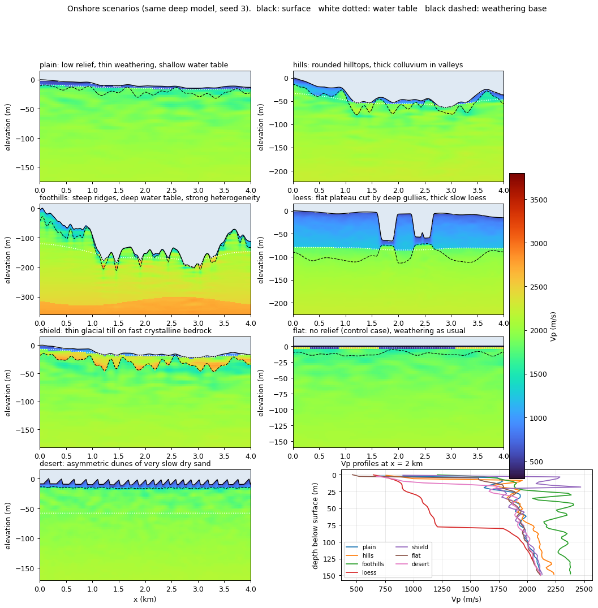
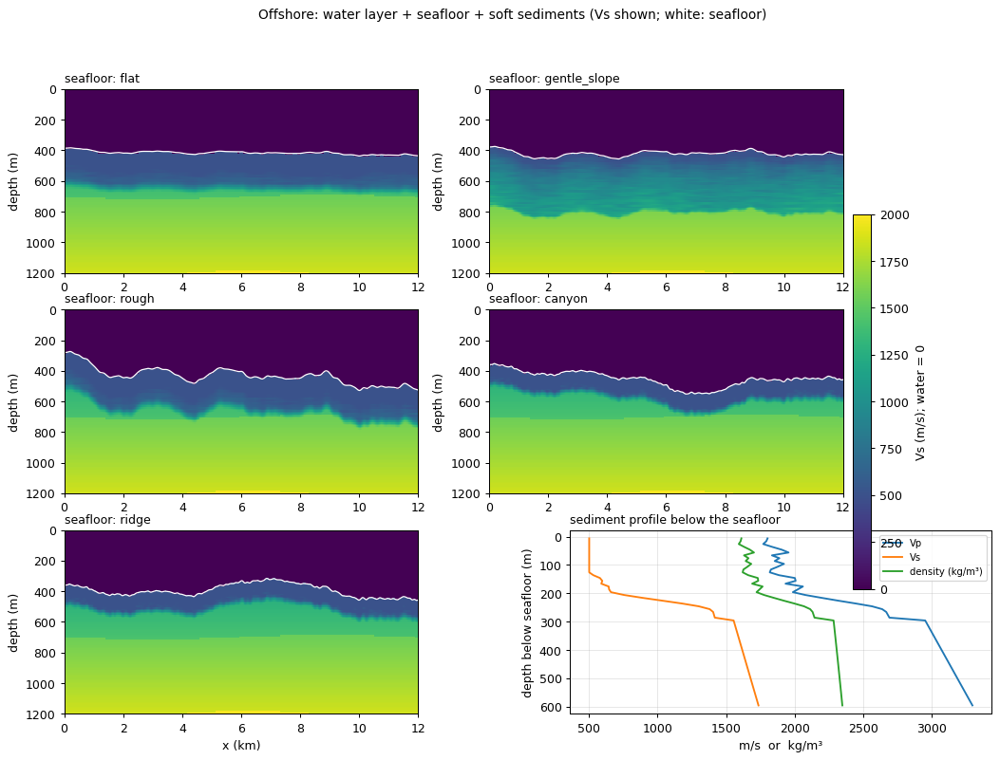
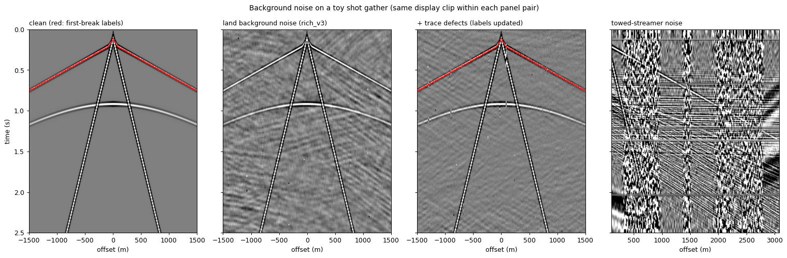

# nearsurf

[](https://github.com/zzzzswh/nearsurf/actions/workflows/test.yml)
[](LICENSE)


**Realistic near-surface for 2D synthetic seismic data.** Give it a deep velocity model and it adds rugged
topography, a weathering layer, a water table and small-scale heterogeneity (seven onshore scenarios), or a
water layer, seafloor and soft sediments (offshore), together with the ground truth of every interface.
Give it a clean shot gather and it adds field-like background noise and trace defects.

Pure numpy / scipy, independent of any wave-equation solver, and bit-for-bit reproducible from a seed.

[中文说明](README.zh-CN.md)



## Why

Synthetic data is usually too clean exactly where real data is hardest: the near surface. Static corrections,
first-break picking, ground-roll attenuation and near-surface inversion all depend on a slow weathering layer,
irregular topography and noise. `nearsurf` turns any deep model (a geological model, Marmousi, a layered earth …)
into one with a plausible near surface, so the data you simulate on it look and behave like field data, and you
keep the truth for training or validation.

## Install

```bash
pip install git+https://github.com/zzzzswh/nearsurf.git
pip install "nearsurf[plot] @ git+https://github.com/zzzzswh/nearsurf.git"   # with matplotlib for plotting
```

Requires Python ≥ 3.10, numpy and scipy.

## Quick start

```python
import numpy as np
import nearsurf

# A deep model: (nz, nx) in m/s, row 0 = top of the model, depth increases downward.
dh = 5.0
z = np.arange(200)[:, None] * dh
vp_deep = np.repeat(2000.0 + 1.2 * z, 600, axis=1).astype(np.float32)
vs_deep = vp_deep / 1.8

# Onshore: add a near surface
ns = nearsurf.land_model(vp_deep, dh, "foothills", seed=0, vs_deep=vs_deep)
ns.vp, ns.vs        # (nz, nx); 0 above the surface (air)
ns.surf_z           # true surface depth per column (m)
ns.surf_idx         # first solid grid row per column (for staircase free-surface solvers)
ns.wt_z, ns.base_z  # water table and weathering base (m): ground truth
ns.params           # every parameter drawn for this realisation

# Offshore: water layer + seafloor + sediments
sea = nearsurf.marine_model(vp_deep, vs_deep, dh, seed=0)
sea.vp, sea.vs, sea.rho, sea.seafloor_z      # vs = 0 and rho = 1025 in the water

# Background noise on a clean gather (ntr, nt); first-break labels are sample indices (nt = no label)
rng = np.random.default_rng(0)
gather = rng.standard_normal((96, 1000)).astype(np.float32) * 1e-3
offsets = (np.arange(96) - 48) * 25.0
labels = np.full(96, 300)
noisy, labels_out, info = nearsurf.land_noise(gather, dt=0.002, preset="rich_v3", seed=0,
                                              offsets=offsets, label=labels, defects=True)
streamer = nearsurf.streamer_noise(gather, dt=0.002, dx_rec=12.5, seed=0)    # towed-streamer noise
```

The full interfaces are `nearsurf.land.build`, `nearsurf.marine.build`, `nearsurf.noise.land.make_noise / corrupt`
and `nearsurf.noise.streamer.make_streamer_noise`; every parameter is documented in the module headers.

## Onshore scenarios

| Scenario | Setting | Relief | Character |
| --- | --- | --- | --- |
| `plain` | alluvial plain | 5–30 m | thin weathering, shallow water table, occasional paleochannels and caliche |
| `hills` | rolling hills | 40–150 m | rounded hilltops, thick colluvium in the valleys |
| `foothills` | mountain front | 150–350 m | sharp ridges, gravel-filled valleys, deep water table, strong heterogeneity |
| `loess` | loess plateau | 60–160 m | flat plateau cut by deep gullies, thick and very slow loess |
| `desert` | dune field | dunes | asymmetric dunes (gentle stoss, steep lee side), very slow dry sand, desert crust |
| `flat` | flat surface | 0 | weathering and water table as usual: a control case for topography |
| `shield` | crystalline shield | 10–60 m | thin glacial till directly on bedrock faster than 5.5 km/s |

How a model is built (details and references in [`nearsurf/land.py`](nearsurf/land.py) and
[`docs/references.md`](docs/references.md)):

1. **Topography**: fractional Brownian motion shaped by hillslope diffusion and a slope limit
   (or plateau + gullies, or dunes), cut into the deep model (erosional truncation).
2. **Weathering thickness**: thicker in hollows, thinner on steep slopes (soil-production models);
   loess thickness follows elevation; dunes are their own weathering body.
3. **Water table**: a smoothed copy of the topography; how closely it follows depends on the scenario.
4. **Velocities**: a dry layer with a power-law gradient, a jump at the water table, an optional fast crust or
   slow channel fill, a smooth transition into a fractured top of the deep model, and an anisotropic random field
   that decays with depth. Vs uses a dry Vp/Vs and does not jump at the water table (fluids carry no shear).

Each scenario defines parameter *ranges*, and every realisation draws one value from each. Narrow or shift them
with `overrides`, e.g. `overrides={"relief": [100, 100], "het": [0, 0]}`. Give a `[a, a]` range rather than a
scalar: that keeps the random-number sequence, and therefore everything else in the model, unchanged.

`v_floor` / `vs_floor` clip the slowest velocities. Your solver's grid cannot resolve arbitrarily slow waves,
so set them from your grid spacing and frequency.

## Offshore



A flat sea surface, a water sound-speed profile, five seafloor styles (`flat`, `gentle_slope`, `rough`,
`canyon`, `ridge`) and soft sediments whose Vp/Vs drops from 4–8 at the seafloor towards about 2.2 at depth.
The deep model is truncated by the seafloor.

## Background noise



| Where | Function | Components |
| --- | --- | --- |
| land / ocean-bottom nodes | `land_noise` (`noise.land`) | coloured ambient noise, power line, spikes, bursts, patchy and common-mode low-frequency noise, machinery harmonics, wind gusts, air blast; **trace defects**: dead traces, polarity flips, gain jitter, clipping, ringing, telemetry dropouts |
| towed streamer | `streamer_noise` (`noise.streamer`) | swell, seismic interference, strumming, cross-feed ([Hlebnikov et al., 2022](https://doi.org/10.1190/geo2019-0808.1)) |

Presets (`nearsurf.NOISE_PRESETS`): `base`, `rich`, `rich_v3` (background level set from the far-offset
first breaks, far-offset SNR 10–22 dB) and `obn` (no air blast, quieter). Trace defects remove the first-break
labels of the traces they kill.

## Conventions

- Models are `(nz, nx)`, row 0 is the top of the model and depth increases downward; lengths in m, velocities in m/s.
- Above the ground (air) or the sea surface, `vp = 0`.
- Gathers are `(ntr, nt)`; first-break labels are sample indices and `nt` means "no label".
- All randomness comes from `seed` (an int or a `numpy.random.Generator`): the same seed always gives the same
  model or noise, bit for bit.

## Development

```bash
git clone https://github.com/zzzzswh/nearsurf.git && cd nearsurf
pip install -e ".[plot]"
python tests/test_nearsurf.py        # also run by GitHub Actions on Python 3.10–3.13
python examples/make_figures.py      # regenerates docs/images/
```

## Citing

If `nearsurf` helps your work, please cite the repository:

```bibtex
@software{nearsurf,
  author = {zzzzswh},
  title  = {nearsurf: near-surface models and background noise for 2D synthetic seismic data},
  url    = {https://github.com/zzzzswh/nearsurf},
  year   = {2026}
}
```

## License

[MIT](LICENSE)
